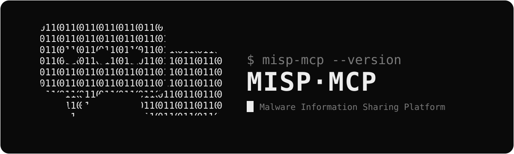
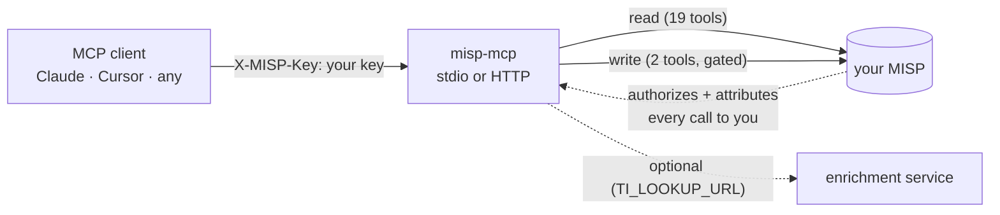
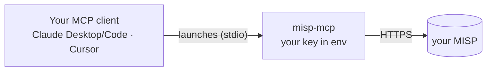
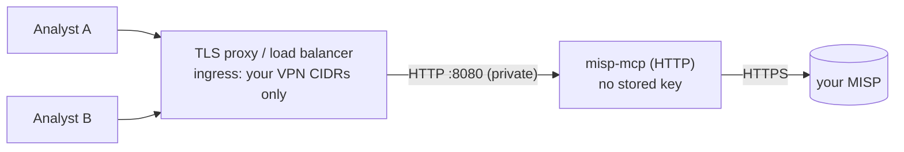

<p align="center">
  <picture>
    <source media="(prefers-color-scheme: light)" srcset="assets/banner-light.svg">
    
  </picture>
</p>

<p align="center">
  Ask about a threat indicator in plain language and get an answer from MISP.
</p>

<p align="center">
  
  
  
  
</p>

---

misp-mcp connects [MISP](https://www.misp-project.org/) to any
[MCP](https://modelcontextprotocol.io) client (Claude Desktop, Claude Code,
Cursor, and others). You ask in plain language, the client calls MISP, you get
the answer. No MISP UI, no REST calls by hand.

It exposes **22 tools**: 19 read (indicators, events, feeds, the galaxy /
taxonomy / tag knowledge base, warninglist checks, worker/job health), 2 gated
write (add indicators, single + bulk), and 1 optional enrichment bridge. Every
call runs under **your own MISP key** - the server holds no credential of its
own.

## How it works



- **Your key is the credential.** It rides in a header; MISP validates it on the
  real call and attributes the query to you. No shared account.
- **Read by default, writes gated.** A read-only key can look things up; adding
  indicators needs a write-capable key (held by the security team).
- **Enrichment is optional.** Set `TI_LOOKUP_URL` to bridge to a MISP-first
  enrichment service; unset, the tool stays hidden and this is a pure MISP
  client.

---

## Get started

Two ways to use it. If you have your own MISP, **run it locally** (below). If
your org already hosts misp-mcp, skip to [Connect to a hosted
server](#connect-to-a-hosted-server).

### Run it locally

Your MCP client launches misp-mcp as a local process (stdio) that talks to your
own MISP with your key. One user (you), nothing to host.



> **Where's your MISP?** `MISP_URL` is your MISP's address, wherever it runs -
> a local Docker instance (`https://localhost`), one on your network
> (`https://misp.lan`), or a cloud-hosted one (`https://misp.yourco.com`). Only
> the URL changes. For a local or self-signed instance, also set
> `MISP_VERIFY_TLS=false`. misp-mcp just needs to be able to reach that URL -
> join your VPN first if the MISP is private.

1. **Install it** from source:

   ```bash
   git clone https://github.com/indranilroy99/misp-mcp.git
   cd misp-mcp
   ./install.sh
   ```

   `install.sh` checks your environment, installs the `misp-mcp` binary, and can
   auto-write your client config. Manual steps are in
   [ONBOARDING.md](ONBOARDING.md).

2. **Point your client at it.** Add a stdio server with two env vars -
   `MISP_URL` and your `MISP_API_KEY`. Claude Code, one command:

   ```bash
   claude mcp add misp --scope user \
     -e MISP_URL=https://misp.example.com \
     -e MISP_API_KEY=YOUR_KEY_HERE \
     -- misp-mcp
   ```

   Other clients: add an `mcpServers` entry running the `misp-mcp` command with
   those two env vars, then fully restart the app.

3. **Try it.** Ask your assistant *"Is MISP healthy?"* or *"Look up 8.8.8.8 in
   MISP."* If it answers from MISP, you're set.

Prefer Docker or a team deployment? See [Host it for a team](#host-it-for-a-team).

### Connect to a hosted server

If your org runs misp-mcp behind a URL, there's nothing to install - point your
client at it with your own key. You must be on the network / VPN that can reach
it.

1. **Get your MISP key** (one time): open MISP → **My Profile → Auth Keys → Add
   authentication key**, comment it `misp-mcp <your-name>`, copy it (shown
   once). A read-only key is enough for lookups. Keep it private - every query
   runs *as you*.

2. **Add the server** - any MCP client that speaks streamable HTTP with custom
   headers works. It needs three things: transport `http`, the URL, and two
   headers.

   ```json
   {
     "mcpServers": {
       "misp": {
         "type": "http",
         "url": "https://misp.example.com/mcp",
         "headers": {
           "X-MISP-Key": "YOUR_KEY_HERE",
           "X-MISP-User": "you@example.com"
         }
       }
     }
   }
   ```

3. **Check it works**: this should print `401` (endpoint reachable, auth
   required):

   ```bash
   curl -s -o /dev/null -w '%{http_code}\n' -X POST https://misp.example.com/mcp
   ```

<details>
<summary><b>Per-client setup (Claude Code, VS Code, Cursor, others)</b></summary>

**Claude Code** (one terminal command):

```bash
claude mcp add --transport http misp https://misp.example.com/mcp \
  --scope user \
  --header "X-MISP-Key: YOUR_KEY_HERE" \
  --header "X-MISP-User: you@example.com"
```

**Claude Desktop / Cursor / Windsurf** - add the `mcpServers` block above to the
client's MCP JSON config, then fully restart the app.

**VS Code (Copilot MCP)** - in `.vscode/mcp.json` or user settings, under
`"servers"`, use the same `type`/`url`/`headers` shape.

**Cline / Continue / Zed / Goose and others** - same URL, `http` transport, and
the two `X-MISP-*` headers, in whatever config format the client uses. Any
client that cannot send custom HTTP headers is not supported (the key must ride
in `X-MISP-Key`).

</details>

<details>
<summary><b>Tools missing or stale? Reconnect.</b></summary>

MCP clients cache the tool list at connect time. If tools are wrong or the
server was updated, **fully quit and reopen the app** (an in-app reconnect or a
new chat is often not enough). Still stale: remove the `misp` server, save,
reopen, add it back, reopen again.

Claude Code:

```bash
claude mcp remove misp
# then re-add (see above) and fully restart Claude Code
```

</details>

---

## What you can ask

```
"Look up 102.130.113.9 in MISP."
"Triage these 30 IOCs from the report."
"What else showed up in the same event as evil[.]com?"
"Review the last 30 days of IOC submissions - who added what."
"Is MISP healthy? How many feeds are on?"
```

Paste indicators however you have them - defanged forms (`1.2.3[.]4`,
`hxxp://evil[.]com`) are cleaned up automatically; private/reserved IPs are
rejected. Behind the scenes a tool returns structured JSON, e.g. a lookup:

```json
{
  "ioc": "102.130.113.9", "ioc_type": "ipv4", "total_hits": 6,
  "summary": { "seen_in_misp": true, "detection_flagged": true,
               "max_threat_level": "Medium", "restricted_hits": 0 },
  "hits": [ { "event_id": "16989", "event_info": "Tor exit nodes feed",
              "value": "102.130.113.9", "to_ids": true, "restricted": false } ]
}
```

## Tools

| Tool | | What it does |
|---|---|---|
| `misp_lookup_ioc` | read | Sightings of one IPv4/IPv6, domain, URL, or hash, with a verdict |
| `misp_lookup_iocs` | read | Triage many indicators in one call |
| `misp_correlate_ioc` | read | Other indicators in the same event, for pivoting |
| `misp_get_event` | read | One event: info, tags, attributes |
| `misp_search_events` | read | Search events by title, tag, or date |
| `misp_feed_stats` | read | How many feeds exist and which are on |
| `misp_instance_status` | read | Reachability + auth check; run first when a tool fails |
| `misp_review_submissions` | read | Audit recent submissions: what was added, by whom |
| `misp_lookup_galaxy` | read | Threat actors, malware, tools, ATT&CK techniques by name or synonym |
| `misp_list_galaxies` | read | Galaxy types available on the instance |
| `misp_list_taxonomies` | read | Taxonomies (TLP, kill-chain, PAP) and whether each is enabled |
| `misp_get_taxonomy` | read | One taxonomy's tags and their meanings |
| `misp_search_tags` | read | Find tag definitions by name |
| `misp_get_object` | read | One MISP object (grouped attributes, e.g. a file object) |
| `misp_get_attribute` | read | One attribute by id, with its event |
| `misp_search_attributes` | read | Search attributes by type, category, tag, to_ids, or event (paginated) |
| `misp_check_warninglist` | read | Flag IOCs that hit known-good / noise lists (false-positive control) |
| `misp_worker_status` | read | Background worker / queue health (admin key) |
| `misp_jobs` | read | Recent background jobs + failures and why (admin key) |
| `misp_submit_ioc` | **write** | Add a new indicator (needs a write-capable key) |
| `misp_submit_iocs` | **write** | Bulk: validate + add many indicators (dry-run preview first) |
| `misp_enrich_ioc` | enrich | Optional: combined verdict via a MISP-first enrichment service (`TI_LOOKUP_URL`); may auto-record confirmed-bad IOCs |

## Security

- **Your key is the authorization.** MISP checks it on every call and attributes
  the action to you. A read-only key cannot write; only write-capable keys can
  add indicators.
- **Guarded write path.** Submissions are rate-limited, well-known / first-party
  infrastructure can never be submitted (anti-poisoning safelist), and the
  submitter is read from MISP itself, not a value the caller sets.
- **Fail-closed TLP.** With server-side redaction on, an event whose tags can't
  be read is treated as restricted, never revealed.
- **Keys stay private.** No shared key on the server; the key rides in a header
  over TLS. Logs never contain keys or IOC values.

Report a vulnerability privately: [SECURITY.md](SECURITY.md).

---

## Host it for a team

Run misp-mcp as an HTTP server so a whole team can use it, each with their own
MISP key. It holds no credential - every request carries the caller's
`X-MISP-Key`, which MISP validates and attributes.



Run it somewhere that can reach your MISP - the same VPC/network if your MISP is
cloud-hosted or private, or alongside it (set `MISP_URL` to its address, as
above). TLS terminates at the load balancer; misp-mcp serves plain HTTP on
`:8080` behind it (or give the process its own cert). Keep ingress scoped to
your caller networks - the endpoint is not public. Pick a path:

| Path | Use it for | Guide |
|---|---|---|
| **Docker** | Fastest single host | see below |
| **Self-host (VM + systemd)** | A team, your own box | [DEPLOY.md](DEPLOY.md) |
| **Cloud (AWS / GCP / Azure)** | Any provider, hand steps | [CLOUD.md](CLOUD.md) |
| **AWS Terraform** | One `terraform apply`, ALB + TLS | [deploy/terraform/](deploy/terraform/) |

**Docker** (bind stays on localhost; front it with your own TLS proxy for remote
use - the key is a bearer credential):

```bash
docker run -d -p 127.0.0.1:8080:8080 \
  -e MCP_TRANSPORT=http -e MCP_HOST=0.0.0.0 \
  -e MISP_URL=https://misp.example.com \
  -e MISP_MCP_ALLOW_INSECURE_BIND=true \
  ghcr.io/indranilroy99/misp-mcp:latest
# or: MISP_URL=https://misp.example.com docker compose up -d
```

The Terraform modules ship two flavors sharing one networking module: **Fargate**
(serverless, no VM) or **EC2** (managed VM, SSM access), each behind an internal
ALB with TLS.

<details>
<summary><b>All settings</b></summary>

| Setting | Mode | Default | Meaning |
|---|---|---|---|
| `MISP_URL` | both | required | MISP base URL |
| `MISP_API_KEY` | local | required | your key (local/stdio mode) |
| `MCP_TRANSPORT` | both | `stdio` | `stdio` for local, `http` for hosted |
| `MCP_HOST` | hosted | `127.0.0.1` | bind address |
| `MCP_PORT` | hosted | `8080` | port |
| `MISP_VERIFY_TLS` | both | `true` | set `false` only for a self-signed lab |
| `MISP_MCP_SHOW_RESTRICTED` | both | `true` | `false` turns on server-side TLP hiding |
| `MISP_SUBMISSION_EVENT_ID` | both | required for writes | event that `misp_submit_ioc` writes to |
| `MISP_MCP_PROTECTED_DOMAINS` | both | empty | your own domains that can never be submitted |
| `MISP_MCP_SUBMIT_RATE` | both | `20` | max submissions per key per minute |
| `MISP_MCP_TLS_CERT` / `MISP_MCP_TLS_KEY` | hosted | none | serve HTTPS directly |
| `MISP_MCP_ALLOW_INSECURE_BIND` | hosted | `false` | allow a public plain-HTTP bind (TLS on a proxy) |
| `TI_LOOKUP_URL` | both | unset | optional enrichment endpoint (enables `misp_enrich_ioc`) |

</details>

<details>
<summary><b>Development</b></summary>

```bash
python3 -m venv .venv
.venv/bin/pip install -e '.[dev]'
.venv/bin/python -m pytest tests/ -q            # 67 tests, offline
```

```
misp_mcp/
  server.py      the tools and the MCP server
  client.py      talks to the MISP REST API (read + write)
  config.py      reads settings from the environment
  http_app.py    hosted mode: header auth + web server
  context.py     carries your identity through one request
  validators.py  cleans, checks, and safelists indicators
```

Dependencies are pinned in `pyproject.toml`: `mcp`, `httpx`, `pydantic`,
`uvicorn`, `starlette`. Licensed under Apache-2.0 ([LICENSE](LICENSE)).
Contributions welcome - see [CONTRIBUTING.md](CONTRIBUTING.md).

</details>
